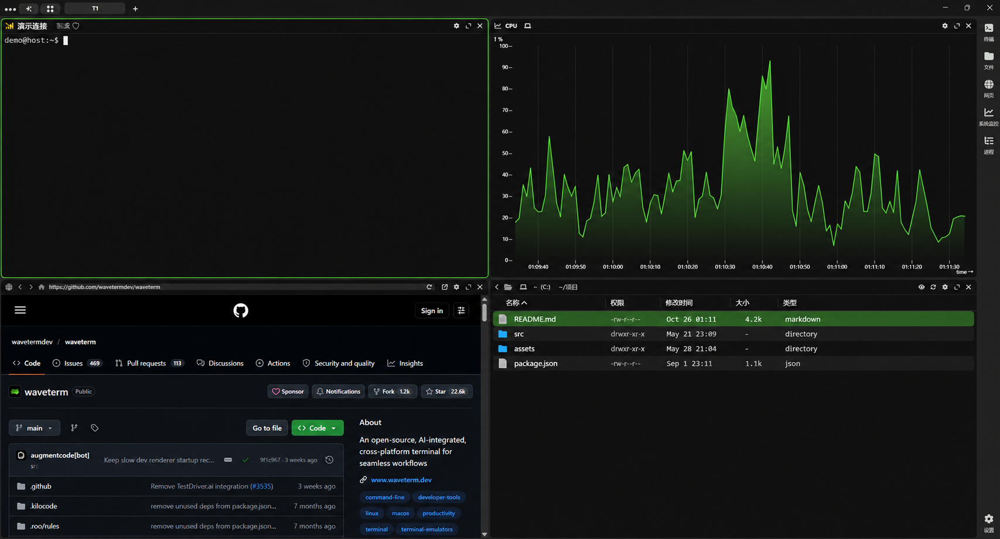

  

<h1 align="center">Wave Terminal 简体中文版</h1>

把终端、文件、网页与 AI 工作流放进同一个桌面环境。

  
  
  
  

  <a href="https://github.com/yang-rz-602/waveterm-zh/releases/download/v0.14.5-zh.1/Wave-ZH-0.14.5-zh.1-public-windows-x64.zip">下载汉化版</a> ·
  <a href="https://github.com/yang-rz-602/waveterm-zh/releases">版本与更新记录</a> ·
  <a href="localization/README.zh-CN.md">构建说明</a>

  

演示界面截图；用户名、主机名和目录已替换为示例内容。

## 版本信息

| 项目 | 说明 |
| --- | --- |
| 基础版本 | Wave Terminal `v0.14.5` |
| 汉化版 | `0.14.5-zh.1` |
| 平台 | Windows x64 |
| Electron | 官方 `41.1.0` |
| 原生组件 | 沿用官方 0.14.5 SSH/backend 组件 |

## 功能一览

| 工作区域 | 内容 |
| --- | --- |
| 终端与会话 | 本地终端、SSH 连接、持久会话和连接状态 |
| 文件与网页 | 文件浏览、网页视图和终端输出预览 |
| 工作区 | 多标签页、分屏组件和侧边栏启动器 |
| AI 助手 | Wave AI 面板、工具确认、模型模式与配置 |
| 系统工具 | 系统监控、进程查看器和凭据管理 |

原生菜单、首次使用引导、常用提示、设置和连接界面均已汉化。翻译表包含 757 条目，自动化转换覆盖 899 处源码文案。

## 安装与首次启动

1. 从 [GitHub Releases](https://github.com/yang-rz-602/waveterm-zh/releases/tag/v0.14.5-zh.1) 下载 Windows x64 压缩包并解压。
2. 运行 `Wave-ZH.exe`。
3. 首次启动会将英文版的连接设置、加密凭据和常用偏好复制到汉化版独立目录。

发布包包含通用程序文件。配置与凭据在本机用户目录中维护；Wave 凭据沿用当前 Windows 用户保护的加密格式。汉化版使用独立配置目录并采用手动更新。

## 本机数据目录

| 内容 | 路径 |
| --- | --- |
| 汉化版设置与连接 | `%USERPROFILE%\.config\waveterm-zh` |
| 汉化版运行数据 | `%LOCALAPPDATA%\waveterm-zh\Data` |
| 汉化版 Electron 配置 | `%APPDATA%\Wave-ZH` |
| 英文版配置来源 | `%USERPROFILE%\.config\waveterm` |

## 汉化范围

原生菜单、连接状态、设置、常用提示、Wave AI 面板和首次使用引导使用简体中文。终端程序输出、命令、网址、配置键、协议字段和用户文件内容保留原文；历史版本说明及部分内置编辑器文案仍可能显示英文。

## 构建与验证

React 界面、Electron 主进程和预加载脚本由本仓库源码重新编译。翻译维护、依赖安装、打包与静态检查步骤见[汉化说明](localization/README.zh-CN.md)。

已检查源码语法与技术字段、应用启动、`zh-CN` 语言标识、加密凭据读取和连接菜单显示。SSH 登录需按实际网络与服务器环境验证。

## 上游与许可

本项目基于 [Wave Terminal v0.14.5](https://github.com/wavetermdev/waveterm/tree/v0.14.5) 修改。上游英文 README 保存在 [`README.upstream.md`](README.upstream.md)。Wave Terminal 使用 Apache-2.0 许可证；发行目录同时保留 Electron 与第三方许可信息。
